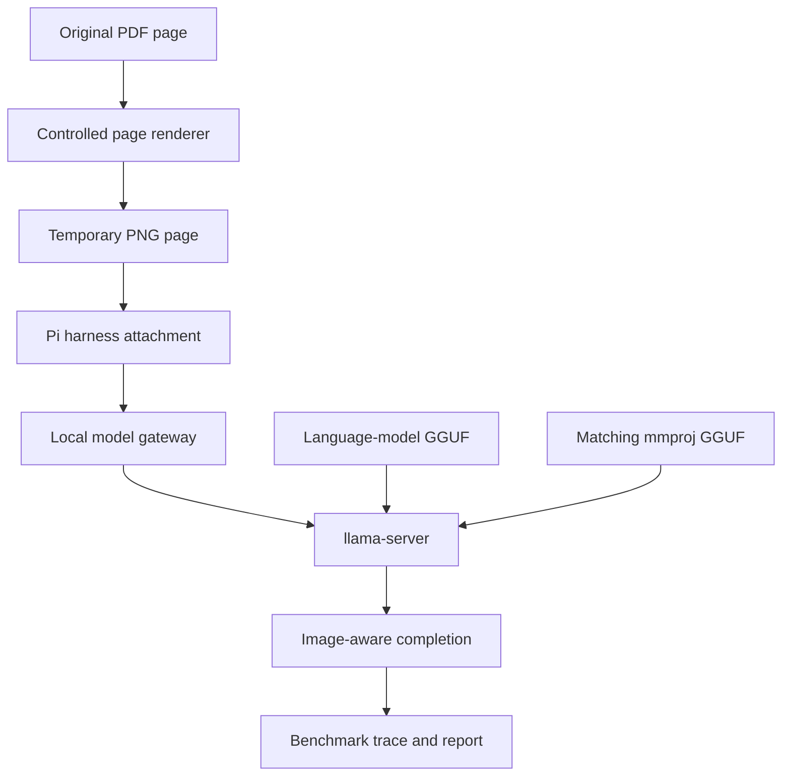

# Multimodal local serving

A multimodal model has two separate requirements: a language-model GGUF and a multimodal projector GGUF. The projector
turns image features into inputs the language model can use. A text-only `llama-server` process can load the language
model successfully while rejecting every image request.



The renderer and Pi attachment are harness responsibilities. The language-model GGUF, matching projector, and
`llama-server --mmproj` configuration are provider responsibilities. All three links must work before a benchmark can
claim that the model saw a PDF page.

## Controlled installation

`install-ai-local-provider` treats a projector as a first-class, optional `model.projector` preset artifact. A vision
preset must pin the projector repository, immutable revision, filename, byte size, and SHA-256. The installer then:

1. downloads or reuses only a checksum-valid projector;
2. starts the unprivileged provider service with `--mmproj <verified-projector>`;
3. verifies ordinary text completion; and
4. sends a small image through the local OpenAI-compatible endpoint and requires a known response.

If the fourth step fails, installation fails. A successful text completion, a model-card claim, or a configured image
field alone is not evidence that vision is available.

Each reviewed vision preset pairs its selected language-model artifact with a compatible projector from the
corresponding model family and immutable revision. Projector size varies by model; the installation plan retains the
prior service until the replacement provider passes its checks.

## Financial Insights benchmark prerequisite

The Financial Insights PDF scenarios can use native visual inspection only when all of the following are true:

- the selected provider has passed the installer image-completion check;
- the selected Pi binding declares text and image input;
- Pi renders the selected PDF page and attaches that image to the request; and
- the run trace records the image attachment and the resulting model response.

When any prerequisite is absent, the scenario reports visual input as unavailable and may use a separately available,
fresh text/OCR method. It must never report visual inspection based solely on a filename, a model claim, or an
unverified server configuration.

## Operations and rollback

Run `preflight` and `install --dry-run` before a remote installation. The installer downloads and verifies artifacts
before it replaces an explicitly named active user service; its failure path restores that service. After a successful
provider check, verify the gateway's model list and image completion before changing any Pi binding or running a PDF
benchmark.

This guide describes a serving capability, not a financial-record processing workflow. It does not authorize reading,
normalizing, or writing financial records.

## Inspecting the loaded capability

There is no standard OpenAI endpoint that lists installed projector files. Treat the provider service configuration as
the artifact record and the live API as the capability record. Inspect both; neither replaces the other.

| Question | Evidence | Example |
| --- | --- | --- |
| Which pinned projector should be present? | The reviewed preset | `model.projector` in the selected vision preset |
| Was that projector loaded at startup? | The systemd unit and service journal | `sudo systemctl cat ai-local-provider-<model>` and `sudo journalctl -u ai-local-provider-<model> -b` |
| Does the server advertise multimodal input? | The server's model metadata | `curl -fsS "$LOCAL_PROVIDER_URL/v1/models"` |
| Can the exact endpoint accept an image? | A small image chat-completion probe | The probe below |

Use the configured provider URL in place of `LOCAL_PROVIDER_URL`; it may be the direct provider or its managed gateway.
The current llama.cpp server documents `/models`, `/v1/models`, and `/props`, and says a client should check the model
metadata for multimodal capability before sending media. See the [llama.cpp server API](https://github.com/ggml-org/llama.cpp/blob/master/tools/server/README.md).

```bash
curl -fsS "$LOCAL_PROVIDER_URL/v1/models" | jq '.data[] | {
  id,
  capabilities: (.capabilities // .meta.capabilities // []),
  modalities: (.modalities // .meta.modalities // [])
}'
```

On compatible llama.cpp builds, a model that loaded a projector advertises a multimodal capability. A missing field or
`completion`-only result means do not send an image. The installer performs the decisive check rather than relying on
metadata alone:

```bash
curl -fsS "$LOCAL_PROVIDER_URL/v1/chat/completions" \
  -H 'Content-Type: application/json' \
  --data '{
    "model": "YOUR_CONFIGURED_MODEL_ALIAS",
    "messages": [{"role": "user", "content": [
      {"type": "text", "text": "Reply with exactly VISION_READY"},
      {"type": "image_url", "image_url": {"url": "data:image/png;base64,iVBORw0KGgoAAAANSUhEUgAAAAEAAAABCAYAAAAfFcSJAAAADUlEQVQIHWP4z8DwHwAFgAI/ScLPNwAAAABJRU5ErkJggg=="}}
    ]}],
    "temperature": 0,
    "max_tokens": 64,
    "chat_template_kwargs": {"enable_thinking": false}
  }'
```

The accepted result contains `VISION_READY`; an error such as `image input is not supported` means the serving stack is
still text-only. Run this probe as a direct terminal operation, not from inside a Pi conversation. Some llama.cpp builds
include internal media-marker data in `/props`; pasting raw `/props` output into a model conversation can contaminate
that conversation's prompt. The projector filename and checksum belong in the preset and service evidence, not in a
Pi task prompt.
