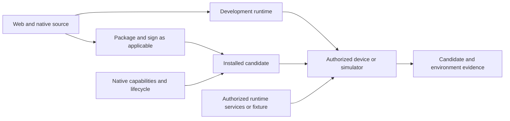
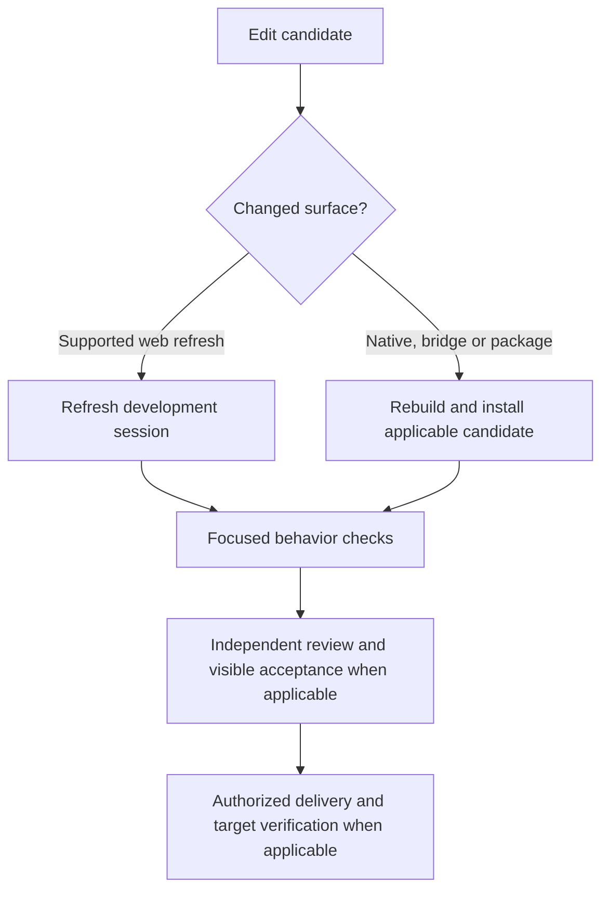
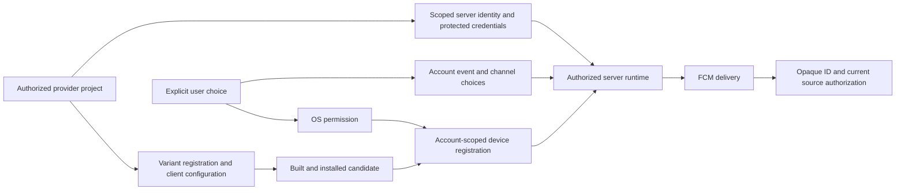

# Mobile development flow

## Purpose and applicability

Apply this [Dev workflow](../dev.workflow.md) flow when work changes a mobile application or a mobile-specific user journey, including native, hybrid and mobile web implementations. It refines planning, implementation, testing, documentation and applicable delivery/deployment using existing roles and gates; it creates no Router stage, command, role or new approval. Follow the [UX and UI flow](ux-ui.flow.md) when user-visible behavior changes. Product-owned business flows remain the source of expected behavior; this workflow does not replace them.

## Entry and design

Designer / Reviewer identifies the authorized product, targets, supported operating systems and devices, intended candidate and relevant [project business scenarios](../../_common/flows/project-business-flows.md). Resolve the product's established flow location, architecture and runbook; record missing or conflicting expectations with an owner before dependent work. Identify user-visible behavior, offline and recovery needs, supported languages, accessibility, device capabilities, account/session behavior, and permitted effects. Select the checks and delivery phase that apply; use existing human decisions and authorizations without creating an extra gate.

Map the actual client boundaries before choosing tools. A mobile web client may run in a browser; a native client may contain platform code; a hybrid client may combine bundled web content, a native shell and bridges. Identify which code, configuration, assets and runtime services each target uses, including authentication and data origins, permissions, deep links, lifecycle and local storage. A web-only edit may refresh a development session; native bridge, manifest, dependency, signing or bundled-asset changes can require rebuilding and reinstalling a shell. Verify the selected framework's actual behavior instead of assuming a live update changes the installed binary. A dev server, simulator or browser preview does not prove the packaged client.

Detect native runtime capabilities through the platform's available interfaces and handle missing or denied capabilities explicitly. A mobile browser remains a web runtime; a viewport size or device category does not establish that a native bridge exists. Choose responsive presentation from the relevant viewport and input capabilities: touch, coarse or fine pointer, and keyboard availability can vary independently of device category. Neither platform, device account, viewport nor a capability flag establishes a product session or grants authorization. The shared API's existing authentication and authorization checks remain authoritative.

## Work within existing Dev stages

1. **Designer / Reviewer — plan.** Record the target matrix and candidate identity, project business scenarios, affected screens and native capabilities, dependencies, environment and authorization, rollback/recovery, and distinct verification needed for web, hybrid or native paths. Classify whether backend changes, a separately delivered mobile client, web assets, configuration, or multiple deliverables are affected. Determine which versions interoperate and their safe sequencing. A shared backend release does not itself ship a separately distributed mobile UI; a client install does not deploy a backend. Record applicability, unrun targets and owners.
2. **Coder — implement and document.** Follow the accepted product behavior and platform constraints. Use a fast development loop where the project supports one, while keeping development endpoints, credentials, transport exceptions and configuration out of release artifacts. Bound access to authorized targets; retain normal certificate validation, authentication, authorization and session isolation. A local proxy or origin adapter, when needed, must be narrowly scoped to owned routes and preserve the intended service and security contracts. Do not weaken production policy to make a development client connect. Update the product's existing runbook and scenario sources through [documentation](documentation.flow.md).
3. **Designer / Reviewer and Command Runner — verify.** Select focused checks from the project scenarios; Command Runner runs authorized mechanical checks and reports their actual result. Record development refresh, native bridge/lifecycle behavior, packaged build/install, integration and runtime service evidence separately as applicable. Include meaningful negative and recovery paths: unavailable development service, missing permission or capability, interrupted session, connection loss, background/resume, and version incompatibility where relevant. Tests must not perform unapproved account, purchase or data mutations. Follow [testing](testing.flow.md); diagnose failures through the existing debugging flow.
4. **Designer / Reviewer and UI Acceptance Tester — review and visible proof.** Review the implementation and candidate-bound evidence; the independent UI Acceptance Tester exercises the affected journeys on selected physical devices or simulators as the plan requires. Check real touch, viewport/insets, keyboard, accessibility, localization, rotation and platform navigation where applicable. Where rotation is supported, record portrait and landscape separately and exercise live transitions with relevant menus or overlays open. For a fixed-orientation product, record the supported constraint and why the other orientation is not applicable. Record device/OS class, client and backend versions, environment, observation and limitations. A mirror or automated screenshot can aid inspection but does not by itself prove interactions, native capabilities or an independent receipt. Do not substitute emulator, browser or hot-reload results for required physical-device or packaged-client proof.
5. **Command Runner and Designer / Reviewer — authorized delivery.** Use the existing [delivery](../guides/delivery.md) and [deployment](deployment.flow.md) routes only when requested and authorized. Distinguish source delivery, signed or unsigned package, device installation, upload, publication and backend deployment. Record artifact identity, version, signing/distribution state, target, actual terminal result and post-deployment proof for each applicable deliverable. A package build, successful upload or control-plane dispatch does not establish that a device received the candidate or that its runtime API works. Verify the selected release and rollback paths independently; report unselected or unrun channels as such.

## Iteration and evidence channels

Use the selected project's supported development transport. A wired device connection, simulator bridge, browser preview or other authorized path may be appropriate; none is universal. For a temporary local development server, choose an available address/port, restrict exposure as appropriate, select the intended device and avoid taking over existing services or mappings. Record how the process and any mapping are owned and removed, how the app behaves if the server is unavailable, and how to return to a normal bundled or release configuration. If a native shell is installed for development, retain user data unless an explicitly authorized scenario requires otherwise. A framework-specific USB reverse mapping is one possible transport, not a requirement for all mobile stacks.

Bind every observation to its actual candidate, device/environment, service target and time. Distinguish passed, failed, blocked, not run and not applicable, with the next owner for a gap. Refresh evidence covers the running development session; only an inspected and tested packaged candidate supports a packaged-client claim. Device acceptance, backend acceptance, publication and production verification remain distinct. A required failed or missing check blocks its dependent decision, while unrelated completed evidence remains recorded.

## Control plane, runtime and product runbook

A deployment control plane initiates or monitors an authorized change; a product's runtime data plane serves the API, streams and other requests used by the client. For example, an authenticated remote shell may operate a deployer while a mobile client uses a separately configured HTTPS API. One connection's readiness, credentials or reachability does not prove the other. Identify each target, trusted route, ownership, result and recovery independently; do not infer that a deployment mechanism is a client API transport or expose its credentials to the app.

The product's existing durable documentation must identify, as applicable:

- supported platforms, architecture and boundaries between frontend, shell/bridges and services; version compatibility and separately delivered artifacts;
- safe setup, device selection, development transport, fast iteration and its limitations, ownership/cleanup of temporary processes or mappings, and recovery to the normal client;
- authorized configuration and secret handling, runtime service origins, local fixtures or proxies, security invariants, and unavailable states without embedding credentials or machine-specific private values;
- the exact product-owned commands and prerequisites for build, signing, installation, testing and release, with the authority and effects of each; and
- scenario-derived verification, independent visible acceptance, device and artifact identity, deployment/runtime evidence, rollback and known gaps.

Keep reusable workflow rules here and product-specific commands, service topology and procedures in the product's own runbook. Keep actual secrets and private operational identifiers out of public documentation. Update the runbook when the supported path changes; a temporary run log is not a durable procedure.

## Exit and recovery

Return to the invoking Dev stage with the selected candidate, applicable evidence, remaining limitations and next owner. A bounded development or preview phase may finish without publication or unrelated distribution channels when those effects were outside scope. Missing evidence blocks only its dependent gate; never describe a development refresh, package build or deploy dispatch as a verified production release. Preserve failure evidence and use the existing debugging, testing and deployment flows for correction and reassessment.

## Optional Firebase Cloud Messaging setup

Use this section only when the selected product needs Firebase Cloud Messaging (FCM). The product's own notification design, provider authorization, delivery gates and runbook remain authoritative; mobile support does not require Firebase. FCM project/app registration is separate from Google sign-in OAuth registration and store publication. A Firebase registration alone grants neither an application session nor permission to send a notification.

1. Identify the authorized Firebase project and each exact Android application ID used by the relevant debug and release variants. An authorized project owner handles any provider access or terms acceptance through the existing human handoff. Register each applicable variant and obtain its matching [Android client configuration](https://firebase.google.com/docs/android/setup). Verify the selected package in the built candidate; changing an application ID means a different registration. Treat client configuration as public identifiers according to the provider, but follow the product's repository policy for where it is stored.
2. Enable the FCM API where required and select the narrowest practical service identity and permissions for the sending backend. The documented predefined `roles/firebasecloudmessaging.admin` grants **full FCM API read/write access**, not a send-only custom role; assess narrower permitted roles when available. Follow the provider's [FCM IAM roles](https://firebase.google.com/docs/projects/iam/roles-predefined-product) and [HTTP v1 authorization](https://firebase.google.com/docs/cloud-messaging/send/v1-api). Prefer attached or federated, short-lived credentials when the host and implementation support them; otherwise use an explicitly authorized key through the product's secret mechanism and rotation procedure. Never put private credentials in client assets, source, logs or public documentation. See [service-account security guidance](https://docs.cloud.google.com/iam/docs/best-practices-service-accounts).
3. Implement explicit, contextual OS permission requests separately from saved per-event/channel account preferences and device-token registration. Respect denied and unavailable states without claiming delivery. Scope registration to the authenticated account and application, handle token refresh, expiry and sign-out/account switch, and recheck current source authorization before delivery and when an opaque notification ID is opened. Keep message content and arbitrary URLs out of provider payloads unless the product explicitly requires and authorizes them. [Android permission and FCM setup](https://firebase.google.com/docs/cloud-messaging/android/get-started) describes platform requirements.
4. Record client build/sync and installed candidate evidence separately from provider configuration, server runtime credentials and source delivery. Apply schema migrations, feature flags and deployment only through the product's existing authorized rollout; credentials or a successful authentication check do not activate or prove the full path. Record recovery, revocation and ownership in the product runbook.

| Evidence stage | What it establishes |
| --- | --- |
| Provider project and app variants | The selected registrations and matching client configuration exist. |
| Server identity and configuration | The intended runtime can authenticate with the granted scope; it does not prove delivery. |
| Package and permission | The inspected installed candidate and the user's OS permission state, separately from account choices. |
| Registration and delivery | Account/device registration and an authorized message reaching the selected device, including foreground and background as applicable. |
| Open, lifecycle and recovery | Current source authorization, safe navigation, token rotation and sign-out/account-switch behavior. |

Record each applicable stage as passed, failed, blocked, not run or not applicable with the actual environment and candidate; provider setup, OS permission and an end-to-end delivery are different observations.
