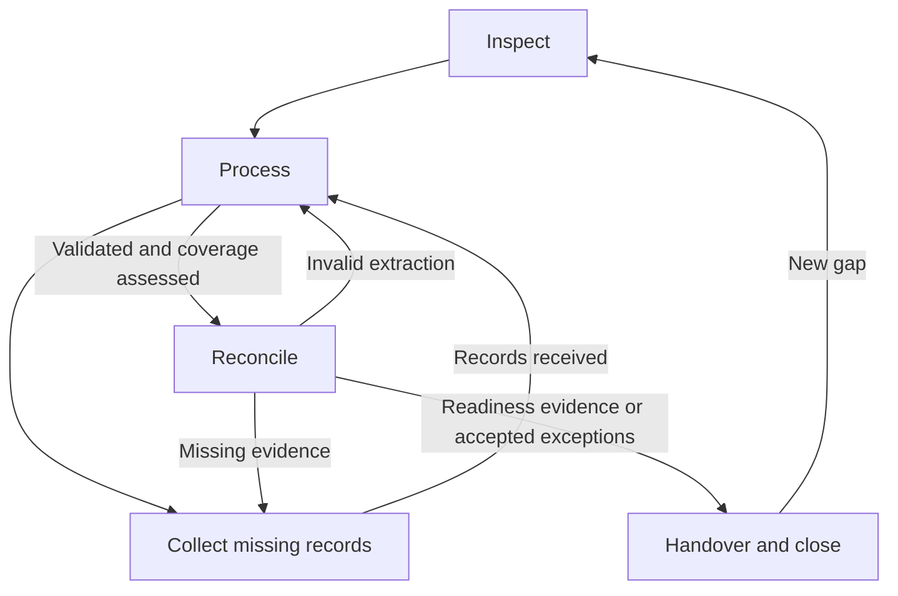

# Financial Insights workflow

## Purpose and entry

Organize explicitly authorized financial records, reconcile the requested period and prepare evidence for human decisions or accountant handover. Report observed facts, calculations, assumptions and missing evidence separately. This workflow is internal financial sense-making, not professional accounting, tax, legal or investment advice.

Start with verified profile/workflow/project authority, selected businesses/accounts/currencies, period and basis, actual storage mapping, permitted effects and available command adapters. Scope or capability gaps block dependent operations. The [quarter-handover flow](flows/quarter-handover.flow.md) is the authoritative ordered procedure below; this documentation is not an executable Router projection.

## Route the request

| Request | Normative route and completion |
| --- | --- |
| Quarter preparation, readiness or accountant handover | [Quarter handover](flows/quarter-handover.flow.md); stop at the requested proven milestone. |
| Place a record or catch up unfinished intake | [Record organization](flows/record-organization.flow.md); normalization and validated adjacent extraction must both pass. |
| Find an invoice, statement or payment fact | [Record lookup](flows/record-lookup.flow.md); return verified requested facts and coverage, without requiring full-quarter closure. |
| Calculate spending | [Spending question](flows/spending-question.flow.md); discover, reconcile and return the supported exact total/basis. |
| Prepare tax payment evidence/form | [Tax payment](flows/tax-payment.flow.md); preserve human final submission and independent settlement proof. |
| Financial dimension of a Governor decision | [Governor question](flows/governor-financial-question.flow.md); return a bounded evidence packet and actual review state. |

Select and read only the relevant [worked example](walkthroughs/README.md), in bounded chunks. Its fictional facts and benchmark references are not operational evidence. Existing records remain legitimate inputs; exact paths and source contents outrank filename guesses.

## Quarter stages

The configured [roster](agents.yml) declares **Admin** as initializer/administration endpoint and **Bookkeeper** as the only operational worker. Bookkeeper owns all five stages; PDF/OCR, extraction, analysis and statement retrieval are capabilities, not additional agents. Admin coordination/emulation follows its own contract and cannot replace an independent review or human approval.

| Stage | Inputs | Bookkeeper action / existing mechanics | Output and completion evidence | Recovery |
| --- | --- | --- | --- | --- |
| 1. Inspect | Verified scope, originals/sidecars, quarter summary | Resolve mapping, read summary and run scoped catch-up inventory | Exact paths, coverage and separate normalization/extraction findings | Unverified scope blocks; changed scope restarts inspection. |
| 2. Process | Unfinished or newly received records | Supported `financial-records`, PDF/OCR and reviewed publisher routes | Canonical identity plus independently validated source-adjacent extraction | Invalid/stale fields return here; unsupported effects stay pending. |
| 3. Collect | Named evidence/coverage gaps | Authorized `statements`, `taxes` and document/browser capabilities | Original records for exact account/period, or explicit missing reason/next action | Every received source returns to Process. |
| 4. Reconcile | Validated extracts, original evidence and coverage | `financial-analysis` and bounded source matching | Income/expense/payment matches, transfers deduplicated, fees/FX and obligation/settlement distinguished | Missing record → Collect; invalid extraction → Process. |
| 5. Handover and close | Reconciliation, exceptions, required review | Existing summary checklist and authorized delivery | Separate evidence for ready, sent, accountant-reviewed and closure-approved | Reopen affected milestones on new gaps; preserve prior events. |

The [quarter flow](flows/quarter-handover.flow.md) defines stage owners, proof, event transitions, blocked/resume behavior and fictional acceptance scenarios. Independent supported work may continue while one record is blocked. A required independent review must come from a real authorized reviewer; the roster does not declare a separate Financial Reviewer. Keep the gate pending when unavailable. The older [Governor delegation acceptance scenario](acceptance/governor-delegation.md) requires distinct actors and is not satisfied by the current two-endpoint roster or relabelled utility agents.

## Records and status

Follow the canonical [record organization flow](flows/record-organization.flow.md): original PDF/image and validated adjacent CSV/JSON; one `<reports-root>/<year>/_common/qN/summary.md`; annual matters separate. `_common` is a derived overview, not an entity or primary source. Read relevant authorized summaries despite generic underscore filters; preserve existing layout/JSON conventions and exclude unrelated private folders.

The summary holds coverage, unfinished reasons/next actions, cross-source explanations and the [seven milestone checkboxes](flows/record-organization.flow.md#quarter-status-checklist). Ready, sent, reviewed and closed are independent evidence-based milestones. Missing material evidence leaves readiness pending unless the accountant explicitly accepts named exceptions; acceptance does not establish reconciliation or closure. Do not create competing knowledge/readiness/preparation folders, duplicate status files or durable combined extracts. Compose combined data from adjacent records on demand.

## Command and persistence boundaries

Load only profile-authorized implementations of [financial-records](../../ai-commands/data/financial-records/financial-records.command.md), [statements](../../ai-commands/data/statements/statements.command.md), [taxes](../../ai-commands/data/taxes/taxes.command.md) and [financial-analysis](../../ai-commands/data/financial-analysis/financial-analysis.command.md). Official Wise collection routes to the command-owned [Wise statements skill](../../ai-commands/data/statements/skills/wise-statements/SKILL.md), then Process; an activity export does not replace an official balance statement.

Canonical changes follow [versioned-data](versioned-data.md), proposal review, eligibility/collision checks and the authorized publisher. No silent overwrite. Read-only extraction can prepare evidence but cannot claim canonical persistence. The portable contract is not proof of an executable adapter: current staged UI intake supports open-quarter `In` PDFs; do not assume existing `Out` normalization is supported. Snow-removal recognition returns bounded review-pending evidence, not completed `Out` normalization or a valid sidecar. UI and no-UI routes should use the same command implementation; until supported integration exists, report unsupported sections pending rather than access private drivers or reproduce an ad hoc engine. Existing human-facing UI behavior remains compatible until separately migrated and acceptance-tested. No generic exporter or continuous watcher is installed by this document.

## Privacy and Governor boundary

Governor requests only bounded financial context; Bookkeeper returns the [evidence contract](evidence-contract.md) packet, calculations, uncertainty, coverage and actual review state. Governor retains cross-workflow strategy and human goals; unrelated private Governor memory does not cross the boundary. Same-context self-review cannot satisfy independence. Keep real identities, records, credentials, provider configuration, account identifiers and machine paths in private authorized stores; public examples remain fictional/sanitized. External messaging requires explicit human authorization.

## Benchmarks and browser assistance

Standalone original-PDF model-and-harness benchmarks use explicitly named prompt documents at three scales (see the [prompt convention](acceptance/README.md)):

- small: [`acceptance/pdf-single-tax.prompt.md`](acceptance/pdf-single-tax.prompt.md), one named PDF;
- medium: [`acceptance/pdf-week-tax.prompt.md`](acceptance/pdf-week-tax.prompt.md), one selected calendar week;
- large: [`acceptance/pdf-quarter-tax.prompt.md`](acceptance/pdf-quarter-tax.prompt.md), one selected quarter.

These prompt documents explicitly bypass normal intake, normalization, sidecar, persistence, reconciliation, INIT, roster,
and agent-routing procedures. Reusing a profile-authorized folder and effective model does not initialize or act as a
managed workflow role. Each prompt also requires reporting whether the selected harness actually passed PDF pages to the model
as native visual input. Declaring image input in a model binding is metadata, not evidence that the live provider and
harness accept it; the benchmark trace establishes the observed capability. The provider, projector, harness attachment,
and verification prerequisites are documented in
[`../../ai-commands/install/ai-local-provider/multimodal-serving.md`](../../ai-commands/install/ai-local-provider/multimodal-serving.md).

## Browser-assisted tax-payment entry

Follow the [tax-payment flow](flows/tax-payment.flow.md) and [tax-payment-entry skill](skills/tax-payment-entry/SKILL.md) for reviewed source-PDF/JSON binding, side-by-side human verification, deliberate field-by-field visible entry and post-submit reconciliation. Re-read each settled field and verify payee, period, dates, components and total before final review. **The human activates final submission.** Passwords/MFA remain human-entered; security challenges or provider-required human entry stop automation. No hidden APIs, script injection, deceptive timing or anti-bot workarounds. Provider confirmation proves submitted/scheduled state until posted settlement is reconciled.

The [compatible benchmark scenario](acceptance/financial-insights-compatible.scenario.md), [fictional dataset](../../ai-profile/example/data/financial-insights/README.md) and [benchmark tooling](../../notes/benchmarks/local-models/fixtures/financial-insights-compatible/README.md) test supported preparation/visual checking separately. Benchmark variants change harness/model settings, not operational scope or review/publication gates.
