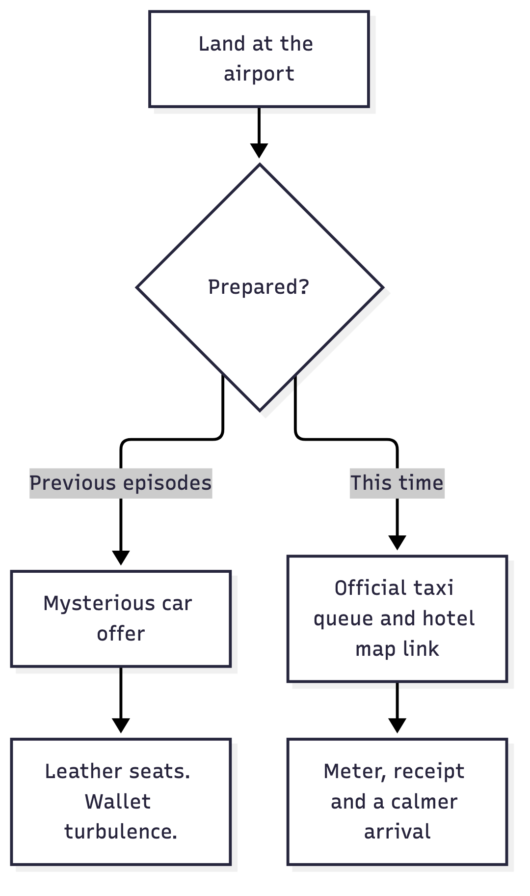
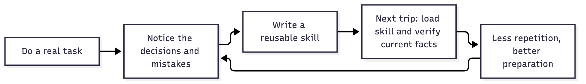

# I Booked a Flight. Then I Built a Skill.

*No way I’m doing all those browser clicks again.*

*One trip. A slightly ambitious backpack. A skill for next time.*

I wanted to book a flight from Montréal to New York for a conference.

A small task. Allegedly.

Then came the questions. When does the conference start? Is the hotel covered for the night before? Which airport? What time should I come back? Does the cheap fare include my backpack? Which card should pay? Where does the receipt go? And how do I get out of the airport without financing somebody’s luxury car?

By the end, I had a ticket, calendar events, transport instructions, an expense folder, an email to the organizer—and a reusable AI Fleas skill.

That last part matters. Whatever I do, I want to ask: **which parts of this should be automated next time?**

After this evening, opening the browser and repeating the whole routine myself? No way.

## The cheap ticket and the ambitious backpack

For the options we compared, booking directly with the airline was cheaper and faster than the original portal itinerary. The direct option had nonstop flights.

Yes, it was a business expense. No, that does not make wasting money a hobby.

But the cheapest fare had a condition: the personal-item allowance.

My perfectly normal laptop backpack turned out to be too big for it. Apparently my backpack has ambitions of becoming a suitcase. Come on.

So we checked the actual dimensions against the fare rules, compared the full round-trip difference, and chose a fare that covered the bag.

That is useful agent work: read the conditions, compare the totals, and explain the decision before I spend money. I still handled the payment step. The agent helped with the surrounding work; it did not acquire unlimited permission to spend on my behalf.

## A calendar should tell me what to do

A flight in the calendar is a start. It does not tell me when to call the car.

We added the practical steps around the flight: leaving home, preparing the mobile passport app during the ride, getting from the arrival airport to the hotel, and leaving the hotel for the return flight. The events had advance reminders and clickable map links.

Those details sound small until you are standing outside an airport, tired, trying to understand which bus goes to which train.

I wanted a regular yellow taxi on arrival. After one too many black-car rides that *felt like a robbery with leather seats*, I wanted instructions I could follow: find the official taxi queue, show the hotel address, use the meter, keep the receipt.

The taxi is not guaranteed to be cheaper than an app ride. Knowing what I am choosing is still an improvement over improvising at the curb.

*Diagram summary: preparation replaces an improvised airport pickup with an official taxi queue, a map link, and a receipt-aware arrival plan.*

There was another distinction worth keeping: preparing the passport app in the car and submitting it at the airport are separate actions. The skill records that distinction and tells the next agent to recheck the current official guidance.

A calendar reminder should help me act at the right time. It should not turn an old assumption into a permanent rule.

## The receipt has a journey too

Once the booking was done, the paperwork started.

During this session, I saved the original airline email and a readable PDF to an authorized private staging folder for travel expenses; that was not a ledger posting or a reimbursement claim. I checked that the PDF included the fare, itemized taxes and fees, tax registration number, currency and total. The figures in the document reconciled.

Then I sent the itinerary and receipt to the organizer I had verified, from the business email account I chose, asking for hotel confirmation and the expense-submission process.

The useful outcome was more than “email sent.” I had verified the recipient and attachment, and my mail application showed the message as sent.

There were limits to what I had proved. A local Synology Drive save did not prove remote synchronization. A planned hotel stay was not an individual reservation confirmation. Staging the receipt did not prove filing, reimbursement, or ledger posting.

Those were my observed session outcomes, not evidence of canonical accounting completion or a completed quarterly filing. Those distinctions belong in automation because they are exactly what gets lost when a system confidently says “done.”

## Capture the decisions while they are fresh

I did not want this to disappear into a chat history.

We created a [Montréal–New York travel skill](../../ai-commands/travel/montreal-ny-travel/SKILL.md) in AI Fleas, with the reusable decisions from the session:

- Compare the whole trip, including baggage and travel time.
- Confirm hotel and conference details separately.
- Add travel actions, advance reminders and usable map links to the calendar.
- Explain the airport transfer so the traveler can follow it.
- Preserve supplier receipts and verify their financial detail.
- Notify the organizer when applicable and authorized.

For expense filing, the skill links to the [financial-insights workflow](../../ai-workflows/financial-insights/financial-insights.workflow.md). The intended compliant model is a human-mediated handoff: stage the receipt in the profile-authorized location, then ask the human to initiate intake through Financial Insights’ approved publisher when that publisher supports the record. Until it does, the record is staged—not filed. The current skill has not yet implemented that model; its Admin-owned correction is pending. My private path is not somebody else’s default.

We also kept booking references, home addresses and payment details out of the reusable skill. The skill should carry the procedure; the current trip supplies the private facts.

*Diagram summary: a completed task becomes reusable instructions, which guide the next task while still requiring current facts to be checked.*

## I want to explain the outcome once

This was an interactive session. I made choices, clarified preferences, and handled the payment. Some details still needed confirmation. We did not build a magic button that books every future trip without me.

We did build something more useful than a one-off answer: instructions that give the next agent a better starting point.

That is the habit I want. When I finish a task, I want the useful parts captured so I do not have to teach them again. Browser clicks, receipt staging, calendar housekeeping—the repetitive work should become easier to delegate every time.

I will still decide where I am going and what I am comfortable spending. But manually reconstructing the whole browser adventure next time?

No way.

If you want to examine the reusable roles and workflows behind that approach, [explore AI Fleas](https://aifleas.com/). If you are applying similar human-directed automation in a business, [see my consulting work](https://starodubtsev.consulting/).
