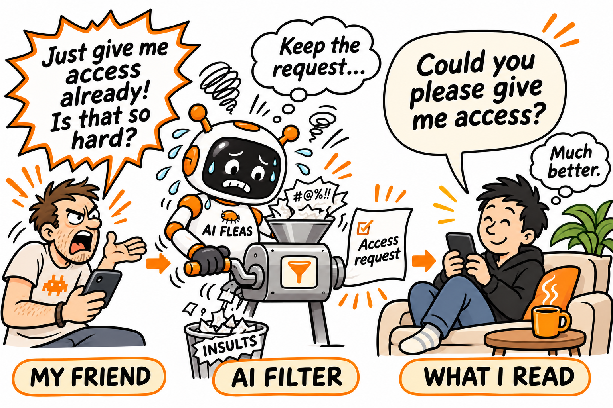
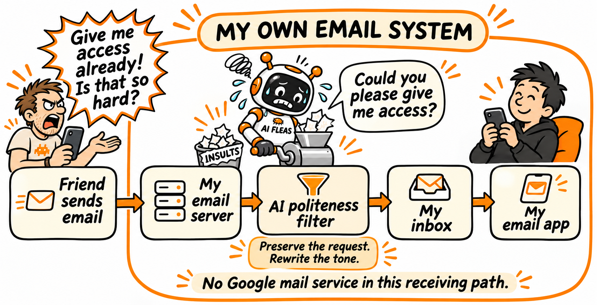

# I Built an Email App Because I Was Tired of Being Polite

*An AI filter keeps my friend's request and removes the part I need to recover from.*

*Same friend. Same request. Less to recover from.*

Some emails give me two jobs: deal with the request, and recover from the way someone made it.

The second job can take longer.

It's especially difficult when the sender is a friend. Knowing each other well can start to feel like permission to say things however we like. Familiarity becomes directness, and directness sometimes gets very close to rudeness.

Meanwhile, I'm trying to understand what the person needs while composing several replies I should probably never send.

I still want to answer calmly. I would just prefer it to require less effort.

So I built a filter.

When an email reaches my system, the filter rewrites insulting language into a polite, direct version before I see it. The request gets through. The personal attack doesn't have to reach my attention.

Here is an illustrative example, rather than a quotation from a friend's actual email:

> “Just give me access already! Is that so hard?”

Becomes:

> “Could you please give me access?”

Now I can decide whether to give access, ask what they need, or say no. Reading a more polite request doesn't oblige me to agree with it. The filter changes the wording; it doesn't grant permissions or make the decision for me.

That distinction matters. I don't want a machine that makes everyone sound delighted. If someone refuses something, I need to see the refusal. If they have a serious complaint, I need to understand it. A deadline must remain a deadline.

The aim is to preserve the information I need without making me process an insult along with it.

We already accept automatic translation between languages. Someone writes in French; you read it in English. Convenient, although you lose a chance to practise your French.

With rudeness, I'm comfortable missing the lesson.

I don't want to become fluent in increasingly unpleasant ways of being addressed. I want polite language that gets to the point.

Of course, to get this one small feature working the way I wanted, I had to build my own email application.

Apparently, that's a reasonable thing to do now.

It also means the receiving email system is mine. This isn't a filter attached to my Gmail inbox: Google isn't providing the receiving mail service in this setup.

*The intended receiving flow: my server, the tone filter, my inbox, my app. The diagram shows the main steps, rather than every infrastructure component.*

Owning the application gives me control over where that filter sits and what I read. It also leaves me responsible for securing the system. Being easy to build and being secure are different achievements.

I'd love to count “nobody knows it exists” as an extra layer of protection. It makes a better joke than a security assessment.

What interests me most is the smaller choice this gives me.

I can't make a friend write more thoughtfully. Asking them to change their tone can itself become another difficult conversation, while the original request waits.

I can change what arrives on my screen.

I started with the problem of how to stay calm after reading an insulting email. The filter moves that work earlier, before I have to react.

Now I can spend my effort on the reply I'll actually send.

---

*More experiments in building personal AI tools: [AI Fleas](../../README.md).*

*The email examples are invented (or not) to demonstrate the filter; they reproduce no private correspondence. See the [visual provenance](assets/2026-11-08-polite-email-filter-visuals.provenance.md).*
